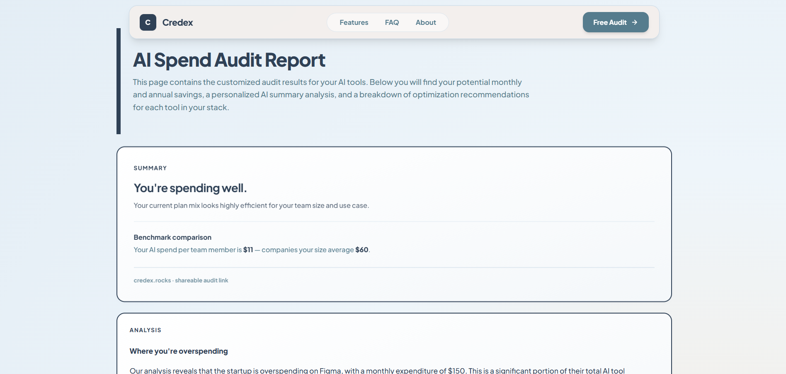
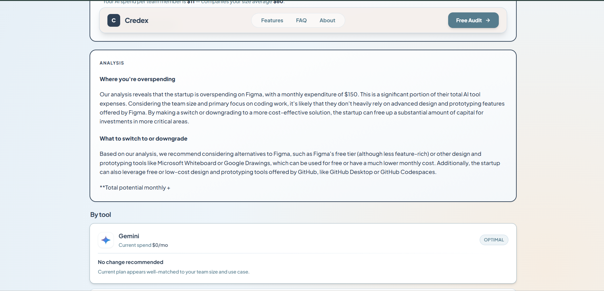
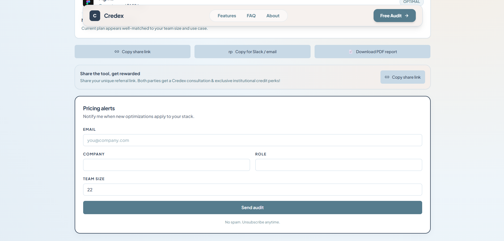

markdown# SpendAudit — AI Spend Audit Tool

A free web app that audits AI tool subscriptions for startup founders and engineering managers, surfacing overspend and recommending cheaper alternatives. Built as a lead generation tool for Credex, which sells discounted AI infrastructure credits. No login required — get your audit in under 2 minutes.

## Live Demo
[https://spend-audit-tau.vercel.app/](https://spend-audit-tau.vercel.app/)

## Screenshots







## Quick Start

```bash
git clone https://github.com/Keerthana-G-Pillai/SpendAudit.git
cd spend-audit
npm install
cp .env.example .env.local
# Fill in your environment variables in .env.local
npm run dev
```

Open [http://localhost:3000](http://localhost:3000) in your browser.

## Project Structure
```text
SpendAudit/
├── app/                   # Next.js App Router — pages and API routes
│   ├── api/
│   │   ├── audit/         # POST /api/audit — runs engine, saves to Supabase, calls Groq
│   │   └── lead/          # POST /api/lead — saves email lead, sends Resend email
│   └── audit/[slug]/      # Public shareable results page
├── components/            # React UI components
│   ├── VisualBuilder.tsx  # Main stack configuration UI
│   ├── AuditResults.tsx   # Results page layout
│   ├── LeadCapture.tsx    # Email capture form
│   └── ShareButton.tsx    # Copy shareable URL
├── lib/                   # Core logic
│   ├── audit.ts           # Pure TypeScript audit engine — no API calls, no React
│   ├── audit.test.ts      # 30 tests covering the audit engine
│   ├── types.ts           # Shared TypeScript types
│   └── supabase.ts        # Supabase client
├── public/                # Static assets
├── .github/
│   └── workflows/
│       └── ci.yml         # Runs lint and tests on every push to master
├── README.md
├── ARCHITECTURE.md
├── DEVLOG.md
├── REFLECTION.md
├── TESTS.md
├── PRICING_DATA.md
├── PROMPTS.md
├── GTM.md
├── ECONOMICS.md
├── USER_INTERVIEWS.md
├── LANDING_COPY.md
└── METRICS.md
```

## Environment Variables

```env
NEXT_PUBLIC_SUPABASE_URL=your_supabase_project_url
NEXT_PUBLIC_SUPABASE_ANON_KEY=your_supabase_anon_key
SUPABASE_SERVICE_ROLE_KEY=your_supabase_service_role_key
GROQ_API_KEY=your_groq_api_key
RESEND_API_KEY=your_resend_api_key
RESEND_FROM_EMAIL=onboarding@resend.dev
NEXT_PUBLIC_APP_URL=http://localhost:3000
```

## Running Tests

```bash
npm run test
```

30 tests covering the audit engine in isolation. All tests are deterministic — no API calls, no database, no React. See TESTS.md for the full inventory.

## Deploy to Vercel

1. Push repo to GitHub
2. Import to Vercel at vercel.com/new
3. Add all environment variables in the Vercel dashboard
4. Deploy

## Abuse Protection

Lead submissions use two layers of protection. First a honeypot field named website — hidden from real users, bots often auto-fill it. If filled the API returns success without saving anything so bots get no signal they were blocked. Second rate limiting — maximum 5 submissions per IP per hour on POST /api/lead, returns HTTP 429 when exceeded.

Honeypot was chosen over hCaptcha because hCaptcha adds friction for real users and a third-party script that hurts Lighthouse scores. The honeypot stops most scripted spam with zero UX cost.

The rate limiter is in-memory and resets on serverless cold starts. For production scale this should move to Upstash Redis as noted in ARCHITECTURE.md.

## Features

| Requirement | Implementation |
|-------------|----------------|
| Spend input form | VisualBuilder component with 10 tools, plan chips, seat steppers, localStorage persistence |
| Audit engine | Pure TypeScript in lib/audit.ts — hardcoded rules, no AI, fully tested |
| AI summary | Groq llama-3.1-8b-instant in app/api/audit/route.ts — falls back to template on failure |
| Results page | /audit/[slug] — public, strips email and company, Open Graph tags for sharing |
| Email capture | LeadCapture shown only after results, never before — honeypot + rate limit |
| Supabase storage | audits table for results, leads table for email captures, RLS enabled |
| Resend email | Confirmation sent on lead capture — notes Credex follow-up if savings exceed $500/mo |
| Shareable URL | nanoid 10-character slug, unique per audit, OG image generated dynamically |

## Decisions

1. **Next.js 14 App Router over Pages Router** — App Router allows per-route metadata for Open Graph tags on the shareable audit URL, a hard requirement. Pages Router would have required a custom _document.tsx workaround and could not generate server-side metadata per dynamic route as cleanly.

2. **Groq over Anthropic API for AI summary** — Groq offers a completely free tier with no credit card required, uses Llama 3 which is more than capable for a 100-word summary, and the API format is nearly identical to OpenAI so integration was fast. The assignment explicitly permitted any LLM.

3. **Hardcoded rules for audit engine instead of AI** — The audit math must be defensible to a finance person with exact numbers. AI introduces hallucination risk on the one part of the product where precision is non-negotiable. During development the LLM hallucinated a ChatGPT Starter plan that does not exist and failed basic multiplication. Deterministic TypeScript functions are auditable, testable, and consistent. This was an intentional architectural decision — knowing when not to use AI is part of the engineering judgment this project demonstrates.

4. **Honeypot over hCaptcha for abuse protection** — hCaptcha adds friction to legitimate users and a third-party script that hurts Lighthouse scores. A hidden honeypot field stops the majority of bot submissions with zero UX impact and no external dependency.

5. **Supabase over Firebase** — Supabase gives a proper PostgreSQL schema with row-level security, making it straightforward to separate public audit data from private lead data. The SQL interface made writing the audits and leads tables intuitive and the free tier is generous enough for this scale.