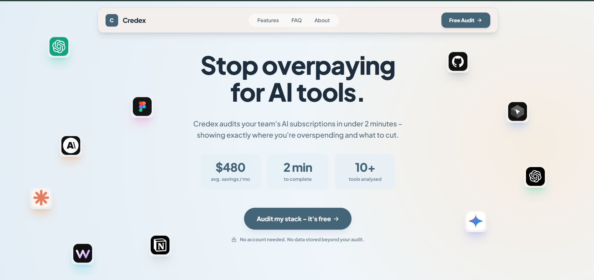
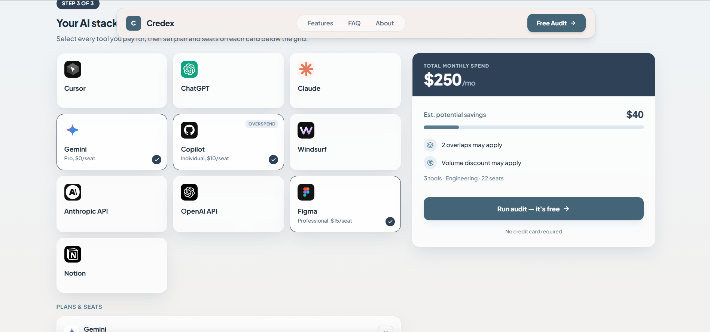
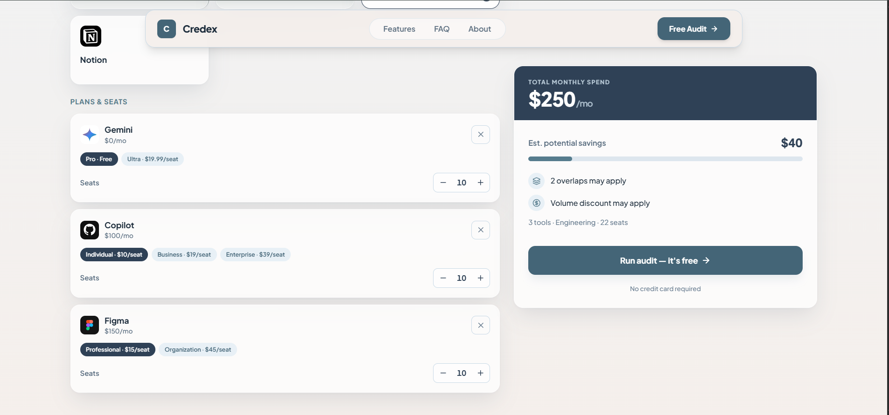

# SpendAudit — AI Spend Audit Tool

## Live Demo
[https://spend-audit-tau.vercel.app/](https://spend-audit-tau.vercel.app/)

## Summary
A free web app that audits AI tool subscriptions for startup founders and engineering managers, surfacing overspend and recommending cheaper alternatives. Built as a lead generation tool for Credex, which sells discounted AI infrastructure credits. No login required — get your audit in under 2 minutes.

## Screenshots






## Quick Start

**Install and Run Locally:**
```bash
git clone https://github.com/Keerthana-G-Pillai/SpendAudit.git
cd spend-audit
npm install
cp .env.example .env.local
# Fill in your environment variables in .env.local
npm run dev
```
Open [http://localhost:3000](http://localhost:3000) in your browser.

**Deploy to Vercel:**
1. Push repo to GitHub
2. Import to Vercel at vercel.com/new
3. Add all environment variables in the Vercel dashboard
4. Deploy

## Decisions

1. **Next.js 14 App Router over Pages Router** — App Router allows per-route metadata for Open Graph tags on the shareable audit URL, a hard requirement. Pages Router would have required a custom _document.tsx workaround and could not generate server-side metadata per dynamic route as cleanly.

2. **Groq over Anthropic API for AI summary** — Groq offers a completely free tier with no credit card required, uses Llama 3 which is more than capable for a 100-word summary, and the API format is nearly identical to OpenAI so integration was fast. The assignment explicitly permitted any LLM.

3. **Hardcoded rules for audit engine instead of AI** — The audit math must be defensible to a finance person with exact numbers. AI introduces hallucination risk on the one part of the product where precision is non-negotiable. During development the LLM hallucinated a ChatGPT Starter plan that does not exist and failed basic multiplication. Deterministic TypeScript functions are auditable, testable, and consistent. This was an intentional architectural decision — knowing when not to use AI is part of the engineering judgment this project demonstrates.

4. **Honeypot over hCaptcha for abuse protection** — hCaptcha adds friction to legitimate users and a third-party script that hurts Lighthouse scores. A hidden honeypot field stops the majority of bot submissions with zero UX impact and no external dependency.

5. **Supabase over Firebase** — Supabase gives a proper PostgreSQL schema with row-level security, making it straightforward to separate public audit data from private lead data. The SQL interface made writing the audits and leads tables intuitive and the free tier is generous enough for this scale.