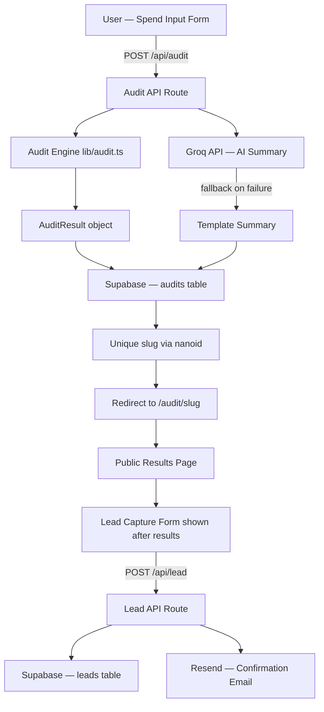

# Architecture

## System Diagram

## Data Flow

1. User fills spend input form on the landing page (form state persists in localStorage)
2. On submit, form data POSTs to /api/audit as JSON
3. /api/audit passes data to the pure audit engine (lib/audit.ts) which returns per-tool recommendations and savings totals — no API calls, just logic
4. /api/audit calls Groq API with the audit result to generate a 100-word personalized summary. On any failure (429, 500, timeout) it falls back to a template string — the audit result is never blocked by the AI call
5. Full audit result + AI summary saved to Supabase audits table with a unique 10-character nanoid slug
6. API returns the slug, client redirects to /audit/[slug]
7. /audit/[slug] is a server component that fetches the audit from Supabase and renders results — email and company name are stripped for the public view
8. Open Graph meta tags on /audit/[slug] enable rich link previews when the URL is shared
9. After viewing results, user optionally submits email via lead capture form (shown only after results, never before)
10. /api/lead saves lead to Supabase leads table, sends confirmation email via Resend

## Stack Justification

| Tool | Why chosen |
|------|-----------|
| Next.js 14 App Router + TypeScript | Per-route OG metadata, server components, strict types |
| Tailwind CSS + shadcn/ui | Fast to build, accessible primitives, meets Lighthouse a11y requirement |
| Supabase | PostgreSQL with RLS, generous free tier, separates public/private data cleanly |
| Groq | Free tier, fast inference, OpenAI-compatible API format |
| Resend | Simplest transactional email API, free tier is sufficient |
| Vitest | Fast, native TypeScript support, no config overhead |
| Vercel | Zero-config Next.js deployment, automatic preview URLs per PR |

## What I Would Change at 10k Audits/Day

1. **Move rate limiting to Upstash Redis** — current in-memory rate limiter resets on every Vercel cold start and does not work across multiple serverless instances. Upstash is edge-compatible and stateless-safe.

2. **Queue AI summary generation** — currently the Groq API call blocks the audit response. At scale, move this to a background job (Vercel Background Functions or a queue like Inngest) so the audit result returns instantly and the AI summary loads asynchronously.

3. **Cache public audit pages** — /audit/[slug] pages are immutable after creation. Add Cache-Control headers or use Next.js ISR so Vercel CDN serves them without hitting Supabase on every request.

4. **Connection pooling** — enable Supabase PgBouncer (available on paid tier) to handle concurrent serverless connections without exhausting the Postgres connection limit.

5. **Separate the audit engine into a shared package** — at scale you may want to run the audit engine in a different context (e.g. a scheduled re-audit job). Extracting lib/audit.ts into a standalone package makes this clean.
